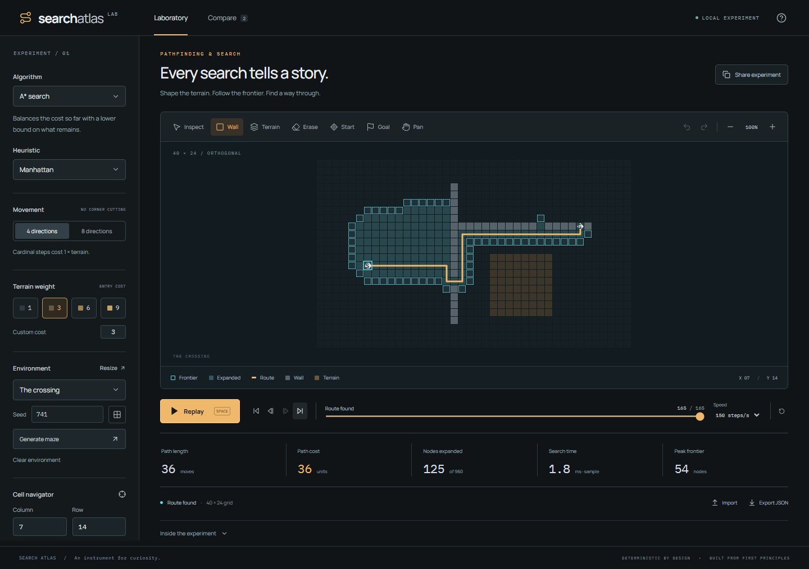
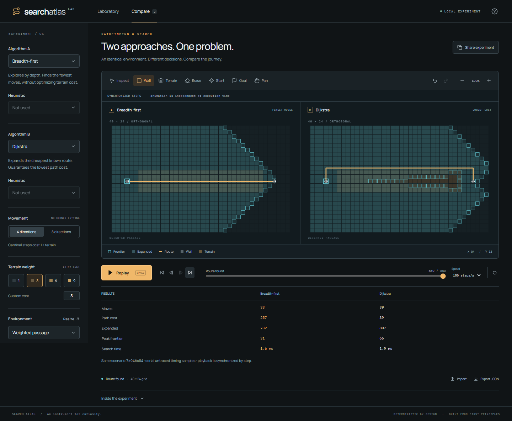

# Search Atlas

**An instrument for curiosity.** An original browser laboratory for constructing pathfinding problems, inspecting search decisions and comparing algorithms on the same terrain.

Search Atlas connects a responsive PixiJS grid to an independently tested TypeScript search engine. Search is computed in a Web Worker; playback follows an exact recorded history. Pause on a decision, inspect its scores and parents, rewind it, or compare a different algorithm without changing the problem.



## Explore

- Four original algorithms: A\*, Dijkstra, breadth-first and greedy best-first.
- Draw obstacles, paint costs 1–9, place endpoints, undo/redo edits, pan and zoom.
- Four or eight directions, with diagonal corner cutting prohibited.
- Seeded backtracking mazes and original weighted, disconnected and open scenarios.
- Play/pause, one-step inspection, reconstruction, full rewind, seek and adjustable speed.
- Two algorithms on one scenario, with linked cameras and synchronized logical steps.
- Inspect path moves/cost, expanded nodes, peak frontier, untraced search duration and precisely defined buffer storage.
- Versioned JSON import/export, local draft recovery and compact scenario links.
- Keyboard editing, a labelled cell navigator, responsive comparison and reduced-motion support.

The practical release limit is **128 × 128 cells**. This limit is deliberate: complete replay and usable interaction matter more than an impressive unverified maximum.

## Run locally

Requires Node.js 22.12 or newer (verified with Node 24.19.0).

```sh
npm ci
npm run dev
```

Open the local URL printed by Vite. A production build is static:

```sh
npm run build
npm run preview
```

No API keys, account or application backend are needed. Fonts are served locally. Browser WebGL and module Web Workers are required for the visual laboratory. When graphics are unavailable, the cell navigator and export remain available with a clear error.

## A useful first experiment

1. Choose **Weighted passage**.
2. Open **Compare**, select **Breadth-first** and **Dijkstra**, then run.
3. Go to the result. BFS chooses fewer moves through expensive terrain; Dijkstra can choose a longer, cheaper route.
4. Rewind and step through the frontier. The cell navigator exposes the parent and current cost/depth.
5. Export JSON or copy a scenario link to reproduce the environment.



## Algorithm guarantees

Moving from u to v costs **step distance × terrain weight at v**. Cardinal distance is 1 and diagonal distance is √2. The starting cell is free; entering the goal incurs its terrain cost. A diagonal requires both adjacent cardinal cells to be open.

| Algorithm | Frontier                           | Objective and guarantee                                                                  |
| --------- | ---------------------------------- | ---------------------------------------------------------------------------------------- |
| A\*       | Indexed binary min-heap, f = g + h | Minimum cost with the supported consistent heuristics                                    |
| Dijkstra  | Indexed binary min-heap, g         | Minimum cost for supported positive terrain costs                                        |
| BFS       | FIFO with head/tail indices        | Minimum number of moves; minimum cost is guaranteed when all legal edges have equal cost |
| Greedy    | Indexed binary min-heap, h         | Finds a reachable goal on this finite duplicate-detected graph; no optimality guarantee  |

Four-direction A* offers Manhattan, Euclidean and zero. Eight-direction A* offers octile, Euclidean and zero. Distances are scaled by the minimum traversable terrain weight. Manhattan is unavailable with √2 diagonals because it may overestimate. There is no heuristic multiplier.

Tie breaking is deterministic: A\* orders by f, h and first discovery; Dijkstra by g and first discovery; greedy by h and first discovery. Neighbour order is north, east, south, west, then the four diagonals. Goal selection happens when removed from the frontier, rather than when first discovered.

BFS is O(V + E). Heap searches with the exposed consistent heuristics are O((V + E) log V), with O(V) working storage on this bounded-degree grid. History is separate from working storage.

## Engineering

```text
Scenario + edit commands
         ↓ immutable snapshot / run ID
Worker → pure engine → recorded transitions
         ↓ packed transferable arrays
Playback history → display projection → PixiJS viewports
         ↘ semantic React controls, inspector and results
```

The engine imports no UI or rendering code. Each run gets independent mutable state. Edits invalidate both comparison runs; stale worker responses cannot replace a newer scenario. Cancellation terminates the synchronous worker and recreates it when needed.

Compact packed deltas restore status, costs, parents, depths, phase and counters. Periodic checkpoints accelerate seeking. Recording has a conservative 24 MiB guard per pane; checkpoints have an 8 MiB numeric-payload ceiling. Exceeding the guard produces an explicit error instead of silently dropping early history. Object overhead and temporary construction peaks are excluded from the payload figures.

Two Pixi applications isolate viewport lifecycles and share camera state. Shared textures, dirty-state updates and on-demand rendering limit repeated work. This is a measured simplification from the original single-renderer proposal; the released two-pane profile is documented below.

See [architecture decisions](docs/ARCHITECTURE.md) and [verification report](docs/VERIFICATION.md).

## Verification and measurements

```sh
npm test
npm run test:coverage
npm run build
npm run test:e2e
npm run benchmark
```

Browser tests expect a running local server. Locally they use installed Chrome; in CI they use Playwright Chromium. Set `ATLAS_TEST_URL` to exercise a production preview. Test browsers are installed separately with `npx playwright install chromium` when required.

The unit suite includes **1,000 seeded generated grids** checked against an independent Bellman–Ford reference, plus heuristic consistency/admissibility, weighted routes, corner cases, heap invariants, deterministic mazes, round trips and replay/seek checks. Generated-case counts are separate from test-file assertion groups.

Raw [engine benchmark JSON](docs/benchmarks/engine.json), [CSV](docs/benchmarks/engine.csv) and [browser profile](docs/benchmarks/browser-profile.json) are committed. The engine benchmark covers 48 algorithm/scenario/size combinations, each with 10 warm-ups and 30 measured runs. These are Node.js engine measurements, explicitly distinguished from browser rendering results.

Metrics are intentionally precise about meaning:

- **Path length:** moves, with geometric distance available in the engine result.
- **Expanded:** cells whose neighbours were examined; terminal goal selection is excluded.
- **Search time:** a separate untraced worker solve including state setup and route reconstruction. Animation, recording, messaging and rendering are excluded. The interface shows a noisy single sample.
- **Algorithm buffers:** exact allocated typed-array byte lengths, excluding JS object overhead, scenario copies, GPU and browser process memory.
- **Replay:** packed trace buffer bytes and checkpoint numeric payload, reported separately.

## Accessibility and current limits

The full editing workflow is available through labelled HTML controls and a cell navigator. Arrow keys move grid focus; Enter applies the tool. W/E/T/S/G/I/P select tools while the grid is focused; Space runs/pauses, Space-drag pans, and Ctrl/⌘+Z undoes an environment edit. Two-finger gestures pan/zoom; explicit controls provide alternatives.

Colour is paired with frontier outlines, filled exploration, route geometry, endpoint shapes, labels and textual results. Automated axe checks cover desktop, help-dialog and phone states. These checks do not establish full WCAG conformance. Real screen-reader, Safari/iOS and physical-phone validation remain unverified in this environment.

Drafts stay in browser storage. Scenario links contain the scenario in the URL fragment; larger scenarios use JSON export. Links are reproduction tools, not cloud saves. Exact trace ordering requires the same engine policy version; timings are hardware- and browser-dependent.

## Originality and publication

All application-specific algorithms, structures, architecture and interface code were authored for this project from scratch. React, PixiJS, Vite and testing libraries are established dependencies; no existing pathfinding implementation, app template, assignment or repository was reused.

The planning artwork is distinct from the actual screenshots above. Dependencies and fonts retain their own licenses; see [third-party notices](THIRD-PARTY-NOTICES.md). No open-source license has been selected for the project-specific code; copyright is retained by the author.
