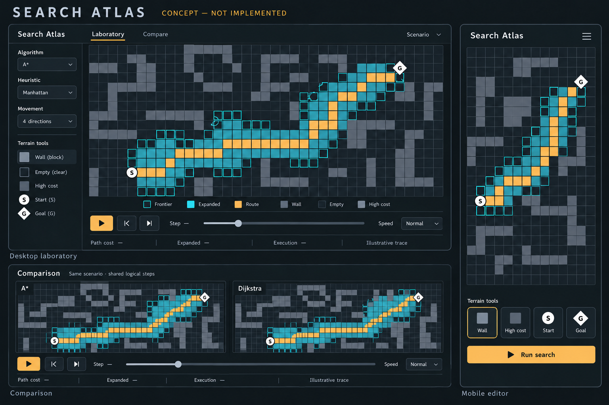

# Search Atlas — visual design and key-screen concepts

**Draft for approval · 22 October 2026.** This document describes the intended interface. Concept artwork establishes mood and composition; the written interaction rules are authoritative. Real screenshots will be captured only after implementation.



Selected concept: revision 2, made with the built-in image-generation tool. [Exact generation/edit prompt](visual-direction-v2-prompt.md) · [Provenance and artwork limitations](visual-direction-v2-provenance.md). Geometry is illustrative. The implemented comparison must display independent measurements for each algorithm, as specified below.

## 1. Creative direction

A precise, quiet computational instrument. Charcoal surfaces and fine structural lines frame a spatial experiment. Cyan identifies exploration; amber identifies the route and the primary action. Typography, alignment and motion provide polish without decorative gradients, oversized hero text or repeated cards.

Use a restrained Search Atlas wordmark with a small original route/grid mark developed during implementation. Avoid borrowing another product's layout, symbols or logo. The stage should occupy at least two-thirds of the main working area on an ordinary desktop layout.

### Proposed design tokens

| Role | Value | Use |
|---|---|---|
| Base | `#101416` | App and empty-grid background |
| Surface | `#191F23` | Rail, transport, menus and sheets |
| Primary text | `#E8EEF1` | Labels, headings and results |
| Secondary text | `#A6B2BA` | Supporting text, never disabled-looking essential controls |
| Amber | `#F0B86A` | Final route and main Run action |
| Cyan | `#67D4DF` | Frontier and keyboard focus |
| Essential boundary | `#60717B` | Controls and distinctions that require visible edges |
| Decorative separator | Muted surface-derived neutral | Quiet structural lines; never sole state information |

Pair amber/cyan-filled controls with dark text. Check actual state combinations and composited colours during implementation; token selection alone is not an accessibility audit. Use a stronger contrast mode for cell distinctions and non-colour patterns.

Typography direction: Manrope for interface text and IBM Plex Mono for coordinates, algorithm notation and numerical results. Confirm distribution licenses before self-hosting font files. Fall back to system sans and monospace. Desktop control text approximately 14 px, mobile 16 px, headings 18–24 px; avoid small uppercase paragraphs. Use tabular numerals for changing values.

Spacing: 8 px rhythm with 4 px adjustments; 16–24 px section gaps. Controls have 6 px radii; menus/sheets at most 10 px. Use restrained borders and a single overlay shadow when needed to distinguish layers. Native control semantics remain intact even when styling is custom.

## 2. Key-screen concept A — desktop laboratory

Reference composition: 1440 × 900, 56 px header, 248 px parameter rail, a flexible stage and approximately 72 px of transport/status. These are starting proportions, not rigid dimensions that cause clipping at zoom.

```text
 Search Atlas       Laboratory   Compare             Scenario name   Import / Export
 ───────────────────────────────────────────────────────────────────────────────────
 Algorithm          Inspect  Wall  Terrain  Erase  Start  Goal  Pan        −  Fit  +
 A*                 ┌─────────────────────────────────────────────────────────────┐
                    │                                                             │
 Heuristic          │                    INTERACTIVE GRID                         │
 Manhattan          │                                                             │
                    │   S ○   exploration                 route              ◇ G  │
 Movement           │                                                             │
 Four directions    │              selected cell + visible focus                   │
                    │                                                             │
 Terrain weight     └─────────────────────────────────────────────────────────────┘
 1   3   6   9      Frontier   Expanded   Route   Wall         Row / Column / Cost
                    ───────────────────────────────────────────────────────────────
 Scenario           Start  Back  Play/Pause  Step    [seek]     Speed     Phase
 Size / Maze / Seed Moves —   Cost —   Expanded —   Search time —   Peak frontier —
```

The rail answers “what am I running?” The toolbar answers “what am I editing?” The transport answers “where am I in the trace?” These groups stay visually distinct.

Clicking a cell with Inspect opens a compact inspector in the rail or a shallow side drawer. It displays terrain and search state independently, plus parent and relevant scores. A paused trace can show the current decision: “Selected the lowest f; improved two neighbouring costs.” The exact values come from the trace, never generated explanatory fiction.

A “Why this result?” disclosure explains the current algorithm's objective and guarantee. It is not a permanently open tutorial. Core settings, Run, tools and playback do not require navigating away from the grid.

### State treatment

- **Not run:** scenario only; metrics unmeasured; Run is primary.
- **Preparing:** stable grid, a concise preparation label and Cancel. No invented progress percentage without a meaningful denominator.
- **Playing:** actual trace updates; Pause is prominent; current phase and step remain legible.
- **Paused:** exact active cell and scores; previous/next buttons available.
- **Reconstructing:** parent links reveal from goal toward start, then the complete route is shown.
- **Found:** route persists, results align in a strip, Replay and Compare are available.
- **No route:** explored region remains visible; “No route under these movement rules”; no fake path or zero cost.
- **Error/resource limit:** readable explanation and recovery action; current scenario remains intact.

## 3. Key-screen concept B — comparison laboratory

```text
 Search Atlas        Laboratory   Compare              Shared scenario / settings
 ────────────────────────────────────────────────────────────────────────────────
 A* · Manhattan                           Dijkstra · heuristic not used
 Lowest cost                              Lowest cost
 ┌────────────────────────────────┐       ┌─────────────────────────────────────┐
 │                                │       │                                     │
 │        SAME SCENARIO            │       │          SAME SCENARIO              │
 │        linked camera           │       │          linked camera              │
 │                                │       │                                     │
 └────────────────────────────────┘       └─────────────────────────────────────┘
                  ONE SHARED TRANSPORT · Synchronized steps
 Start   Back   Play/Pause   Step       [shared seek]             Speed
 ────────────────────────────────────────────────────────────────────────────────
 Metric                                   A*                    Dijkstra
 Moves / Cost / Expanded / Peak frontier   —                     —
 Search time                              Not measured          Not measured
```

Both viewports have equal physical size, scale, endpoints, obstacles and terrain. A shared edit updates both. Hover or keyboard inspection highlights the same coordinate in each; the inspector shows each algorithm's state there.

One logical tick advances each unfinished pane by one search step. Each pane shows its own phase and counters; completion freezes that pane. The shared cursor spans the longer trace. Rewinding restores each pane to its corresponding clamped step. A pane may be reconstructing while the other is searching; phase labels make that difference explicit.

Use neutral aligned result rows, not competitive red/green scorecards. Comparing a more expensive route with a cheaper route is meaningful; declaring an algorithm “faster” from animation is not. Differences in measured duration appear only with their measurement method.

At a width where two useful viewports no longer fit, switch to a labelled A/B view selector with both result columns still visible. Selecting a pane never reruns or resets the experiment.

## 4. Key-screen concept C — small-screen laboratory

```text
 Search Atlas                Lab / Compare       Menu
 ────────────────────────────────────────────────────
 A* · Manhattan                     Settings
 ┌───────────────────────────────────────────────┐
 │                                               │
 │               ZOOMABLE GRID                   │
 │                                               │
 └───────────────────────────────────────────────┘
 Inspect   Wall   Terrain   Erase   More
 Back       Play/Pause       Step       Speed
 [seek]                              Phase / Step
 Moves —   Cost —   Expanded —
 Settings sheet: algorithm / movement / maze / export
```

Support 320 px and wider without page-level horizontal scrolling. At approximately 768 px, collapse the rail into a labelled sheet. At desktop widths around 1100 px and above, expose the rail and two-pane comparison when space permits. Breakpoints respond to content rather than device names.

The grid can pan and zoom internally. The page remains scrollable outside it; browser pinch zoom is not globally blocked. Reserve enough space for transport and safe-area insets. A modal settings sheet manages and restores focus, closes with Escape, and does not hide the only way to stop playback.

Touch actions have about 44 × 44 px targets; desktop controls can use 32–36 px visible sizes with adequate spacing. Individual grid cells need not all meet toolbar target sizes: zoom and the equivalent cell navigator provide precise alternatives. Settings fields use at least 16 px text on small screens.

## 5. Spatial visual vocabulary

| Meaning | Visual treatment | Non-colour information |
|---|---|---|
| Open cell | Charcoal field with subtle cell separation | Empty interior |
| Wall | Solid slate obstacle | Hatch or block silhouette at useful zoom |
| Terrain cost | Quiet neutral texture | Numeral at readable zoom; inspector always exposes weight |
| Frontier | Restrained cyan outline | Hollow-square legend and status label |
| Expanded | Muted cyan interior | Dot/pattern in contrast mode; textual state |
| Current cell | Crisp brighter boundary | Crosshair corners and coordinate readout |
| Route | Amber connected centreline | Continuous geometry, direction cues and route list |
| Start | Neutral high-contrast circle | S |
| Goal | Neutral high-contrast diamond | G |
| Start = goal | Combined endpoint marker | S/G and explanatory text |
| Keyboard focus | Separate visible focus outline | Active-cell coordinates |

Do not let exploration conceal weighted terrain. At low zoom, suppress illegible numerals and expose exact information through the inspector. At high zoom, terrain labels sit above search fills. Route geometry is derived from actual route cells: four-direction paths have orthogonal segments; diagonals appear only under eight-direction movement.

## 6. Editing and keyboard model

Pointer: primary drag applies the selected brush; the Pan tool or Space-drag pans. Wheel/trackpad zoom is anchored to the pointer where appropriate and does not unexpectedly capture ordinary page scrolling outside the stage. Explicit zoom buttons and Fit view are always available.

Touch: one finger applies the active tool; two fingers pan/zoom. Transitioning to two fingers cancels an uncommitted paint gesture rather than adding stray cells. Provide an explicit Pan tool so a multi-finger gesture is never required.

Keyboard commands are scoped to the stage and disabled while typing into fields:

| Input | Action |
|---|---|
| Tab / Shift+Tab | Move between controls and the grid interaction region |
| Arrow keys in grid | Move active cell and reveal it in the viewport |
| Enter in grid | Apply selected tool to the active cell |
| Escape | Cancel the active gesture or close the topmost sheet |
| Space | Play/pause; when held with pointer drag, pan instead |
| W / E / T / S / G / I / P | Wall / erase / terrain / start / goal / inspect / pan while stage is focused |
| Ctrl/Cmd+Z; redo convention | Undo/redo an edit while editor is focused |
| Previous/next controls | Move the replay cursor without changing the scenario |

Provide shortcut help; preserve browser shortcuts and ordinary text editing. A single letter shortcut never activates from outside the focused stage. Separate edit undo from playback rewind in naming, placement and icons.

## 7. Accessibility architecture and acceptance

Target WCAG 2.2 AA for the interface and provide an equivalent operable path through the grid. A conformance claim requires verification. Use semantic DOM buttons, labels, menus, dialogs and result tables; canvas pixels are not an accessible interaction model on their own. Follow the [WAI grid pattern](https://www.w3.org/WAI/ARIA/apg/patterns/grid/) when implementing managed cell focus.

Implement a synchronised, virtualised semantic grid with real row/cell semantics, row/column counts and one tab stop. Maintain the active cell in the accessible tree. Add a visible Cell navigator with row/column fields, terrain editing, endpoint placement and state inspection, so essential tasks do not depend on navigating thousands of cells. Include an accessible result summary and a selectable route-coordinate list.

Announce deliberate cell changes, errors and run completion politely. Do not announce every animated event. Offer an on-demand current-step summary; keep automated playback announcements quiet. Focus is never lost on resize, rerun, renderer recovery or panel switching.

Verification includes text contrast ≥4.5:1 for ordinary text, essential non-text distinctions ≥3:1, visible focus, 200% zoom, 320 px reflow, colour-independent interpretation, reduced motion, keyboard-only full journeys and a real screen-reader session. See [WCAG 2.2 quick reference](https://www.w3.org/WAI/WCAG22/quickref/). Automated accessibility checks support this review but cannot establish canvas usability.

## 8. Motion specification

Control transitions: approximately 120–160 ms. A newly revealed frontier/expanded cell may receive a subtle approximately 160 ms emphasis. Keep effects tied to real events and in a bounded recent-event pool. Never draw a propagation wave through cells the algorithm has not reached.

The playback clock decides which logical states become visible; motion interpolates presentation only. At high speed, apply all logical changes but coalesce visual effects. Seeking lands directly on the target state. No idle animation loop is needed when the grid is unchanged.

With reduced motion: remove pulsing, scaling, trail effects and camera easing; change states directly. Preserve playback, speed and step controls. No initial autoplay, decorative breathing glow or camera flythrough.

## 9. Review evidence

Capture implemented screens at 1440 × 900, 1024 × 768, 768 × 1024 and approximately 390 × 844; also test the 320 px boundary. Review empty, editing, paused, reconstructing, found, unreachable, comparison, validation-error and renderer-error states.

Review long labels, large metric values, keyboard focus, zoomed grids, low zoom, DPR changes and reduced motion. Validate actual screenshots against the specification; do not use generated concepts as README evidence.

The accompanying concept board and its prompt/provenance are planning material only. The final implementation must use neutral endpoint markers, one shared comparison transport, identical comparison environments and genuine run-dependent metrics.

